<p align="center">
  
</p>

<h1 align="center">Switcher</h1>

<p align="center">
  <strong>All your AI subscriptions in one place.</strong><br>
  Switch Claude Code, Codex and Claude Desktop between your accounts in one click,<br>
  keep a share for the chat apps, and let your agents run it for you.
</p>

<p align="center">
  <a href="https://github.com/00xmario/switcher/releases/latest"><strong>Download for macOS</strong></a>
  &nbsp;·&nbsp; <a href="docs/linux.md">Linux</a>
  &nbsp;·&nbsp; <a href="#command-line">Command line</a>
  &nbsp;·&nbsp; <a href="docs/phone.md">On your phone</a>
  &nbsp;·&nbsp; <a href="docs/sharing.md">Share between Macs</a>
  &nbsp;·&nbsp; <a href="docs/details.md">Details</a>
</p>

<p align="center">
  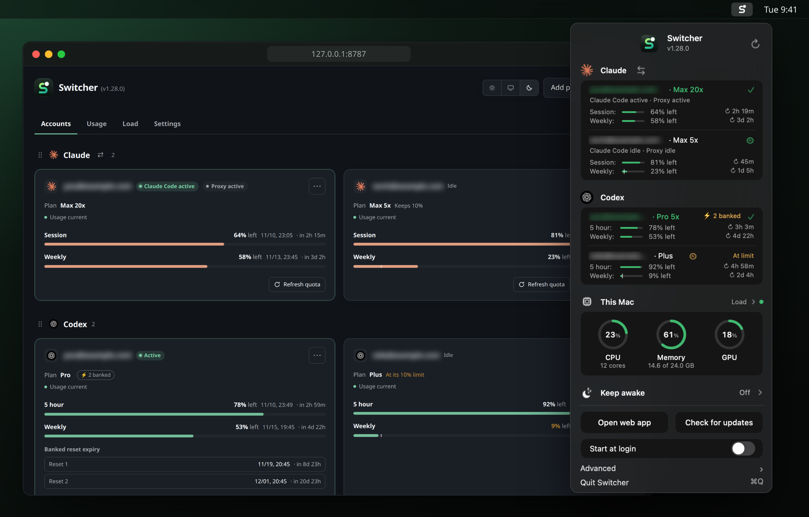
</p>

## Why Switcher

You pay for more than one subscription and want your tools to use the right
one, without logging out, editing config files or interrupting the agents that
are already running. Switcher sits between your tools and the providers on
your own Mac and answers two questions: **which account am I using**, and
**switch me to that one**.

It does not pool accounts or rotate requests between them. Each provider uses
the account you picked until you pick another, until that account runs out,
or until it reaches a usage limit you set; then Switcher moves on to the
account with the most usage left. Errors and limits are the provider's own.

<p align="center">
  
  <br><sub><b>Thirty seconds of Switcher.</b> A usage limit in two clicks, the same by asking your agent, the Load page and the menu bar.</sub>
</p>

## Switch in one click

*Use in Claude Code* switches Claude Code's own login and Switcher's proxy
together; running sessions follow within about 30 seconds. Codex, the T3 Code
hub and, if you want, Claude Desktop use the account you pick. Through the
Desktop relay, Claude Code uses the account you pick and keeps its login, so
Remote Control sessions survive a switch. All of it from the menu bar, the
dashboard or `switcher use`.

**Never stuck at a limit.** When an account runs out, Switcher moves on by
itself. Codex retries the request on another paid account, with a banked reset
before any Free account. Claude Code's login switches to the Claude account
with the most usage left, and a Claude Desktop conversation moves over before
Desktop even sees the refusal.

## Keep a share for the chat apps

The Claude and ChatGPT apps and websites can't be routed, so an account your
tools burn through leaves them nothing. Give that account a **usage limit**,
say 10%: when it has that much of its weekly usage left, Switcher moves your
tools to the account with the most left, and the last 10% stays for chat.

<p align="center">
  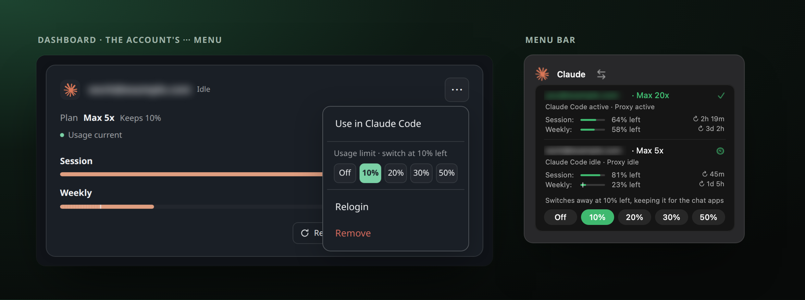
</p>

Two clicks in the dashboard's ⋯ menu or the menu bar, or `switcher limit work
10`. The limit shows as a mark on the weekly bar; an account at its limit says
so. A limit never blocks a request: with no other account that has room,
Switcher stays where it is. On a Mac that uses another Mac's accounts, the
limit is saved on the host and applies everywhere.

## Or just tell your agent

Switcher ships a skill that teaches Claude Code, Codex and other agents what
Switcher is and how to drive it. Say what you want in your own words and your
agent does it:

<p align="center">
  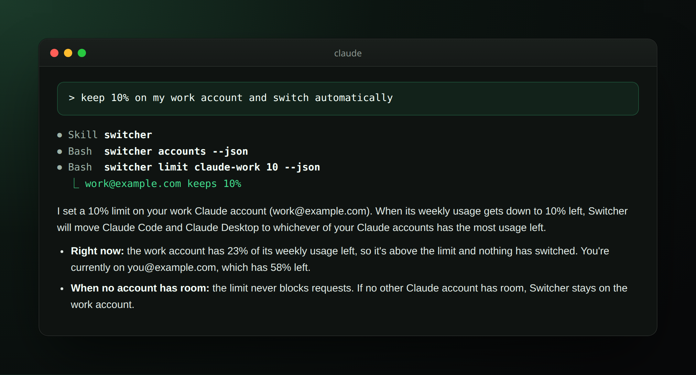
  <br><sub>A real run: Claude Code with the Switcher skill, against made-up accounts.</sub>
</p>

"Keep 10% on this account and switch automatically", "when my work account
reaches 20%, switch to my other one", "what's eating my server?", "which
account am I on?": the skill knows the commands, reads their JSON and never
spends a banked reset or removes anything you did not ask for. A first
install puts it in `~/.agents/skills` and links it for Claude Code; otherwise
add it from **Settings → Command line & tools** or with `switcher skill
install`. On a Mac that uses another Mac's accounts, **Install on both** puts
it on the host too.

<p align="center">
  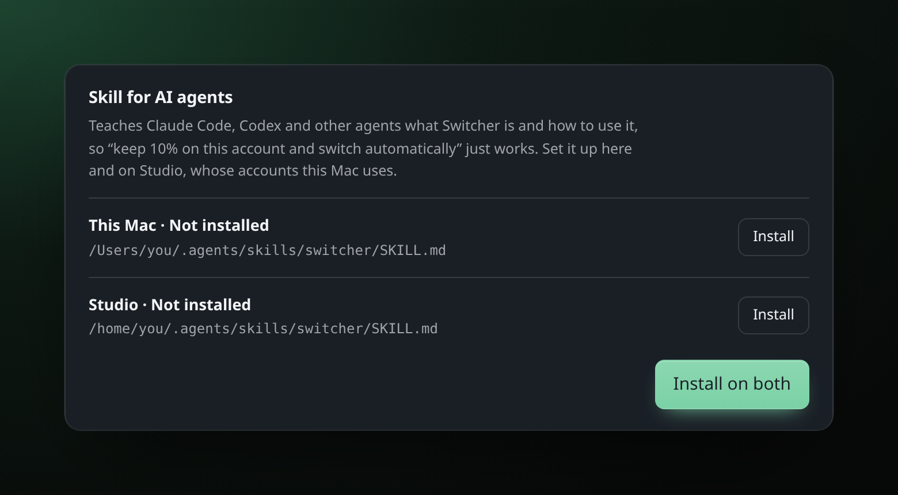
</p>

## See what's using your Mac

The menu bar shows CPU, memory and graphics load as three live rings: this
Mac's, or the host's while you use its accounts. Click them for the **Load**
page: two minutes of history, and every app using the computer, grouped and
ranked by processor, memory or graphics (per-app graphics and graphics memory
on Linux hosts with AMD or Intel graphics). Names only, never arguments or
files; `switcher load --apps` prints the same.

<p align="center">
  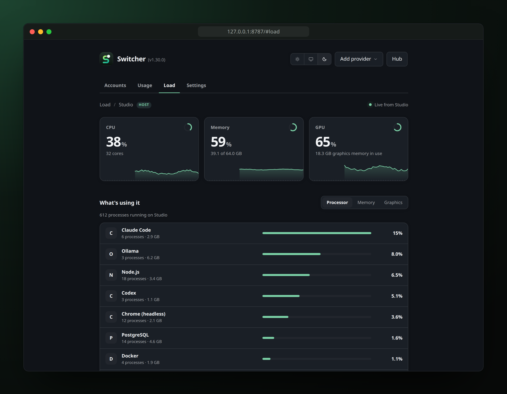
</p>

## Everything else

- **Every quota at a glance.** Session, weekly and monthly windows with reset
  countdowns, in the dashboard and the menu bar, side by side per account if
  you merge them. Optional alerts when a window resets.
- **Share between Macs.** Pair your laptop with your desktop once. Accounts
  and tokens stay on one Mac and the others use them, at home or anywhere with
  the optional Tailscale add-on. Your own Macs on Tailscale connect without a
  code, and switch between hosts in one step.
- **Switcher in your pocket.** Check usage, switch accounts (Claude Code's
  login included) and spend a banked reset from your phone, wherever you are,
  over Tailscale. Setup is a QR code and a six-digit code; only phones you
  approve on the Mac get in.
- **A command line for you and your agents.** Switch, sign in, set limits,
  share between Macs and set up Claude Desktop from a terminal or over SSH,
  with JSON output and stable exit codes.
- **Keep awake for long runs.** From the menu bar, keep the Mac awake for 15
  minutes up to 8 hours, until a set time or until you turn it off, even with
  the lid closed. Sleep comes back by itself when time is up, when the battery
  runs low or when Switcher quits; an update's restart keeps it going.
- **Costs and tokens.** A Usage tab reads your CLIs' own session logs and
  prices them, per day, provider and model.
- **Claude Desktop per conversation.** Optional: pick an account for
  individual Desktop conversations, with no restart per switch.
- **Private by default.** Local only, no telemetry, prompts never inspected,
  and account emails blurred until you hover.

<p align="center">
  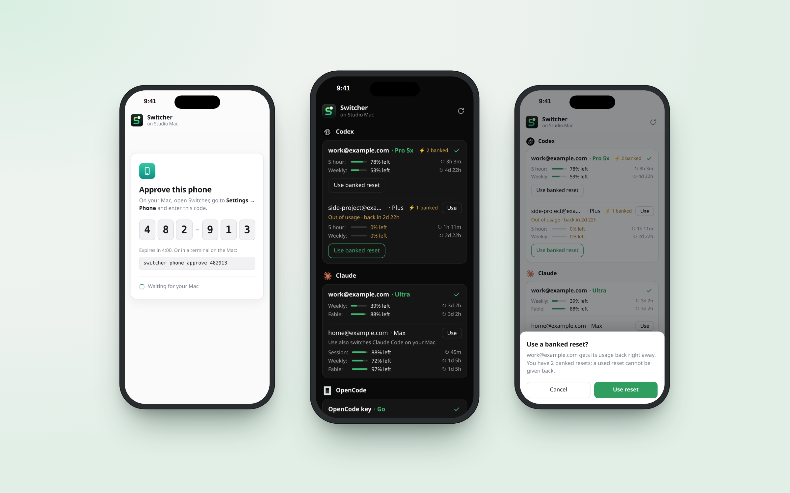
  <br><sub><b>On your phone.</b> Usage, switching and banked resets, over Tailscale, for phones you approve.</sub>
</p>

<table>
  <tr>
    <td width="50%">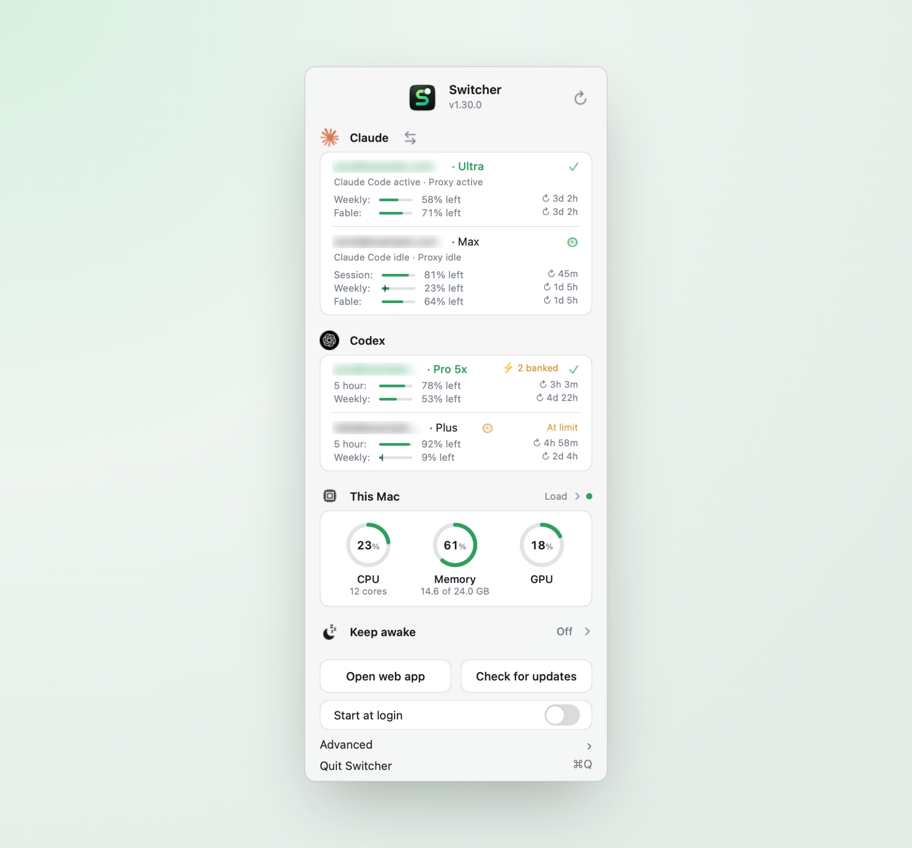<br><sub><b>Menu bar.</b> Usage, limits and load without opening anything.</sub></td>
    <td width="50%">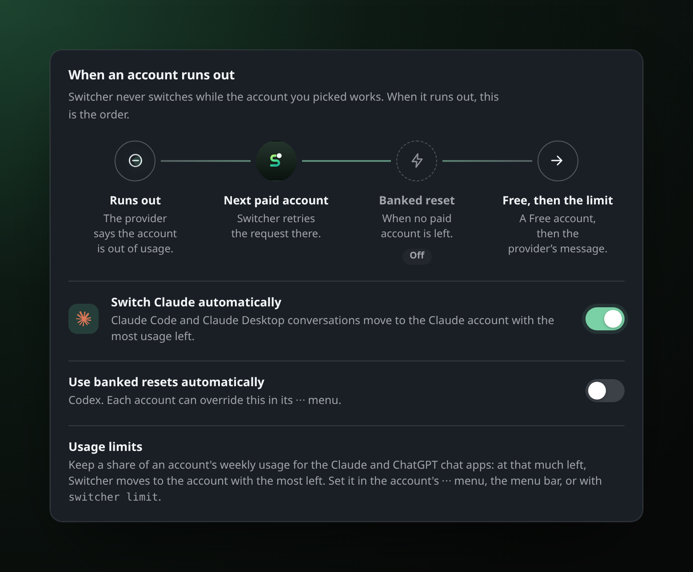<br><sub><b>When an account runs out.</b> Switcher moves on, Claude included.</sub></td>
  </tr>
  <tr>
    <td>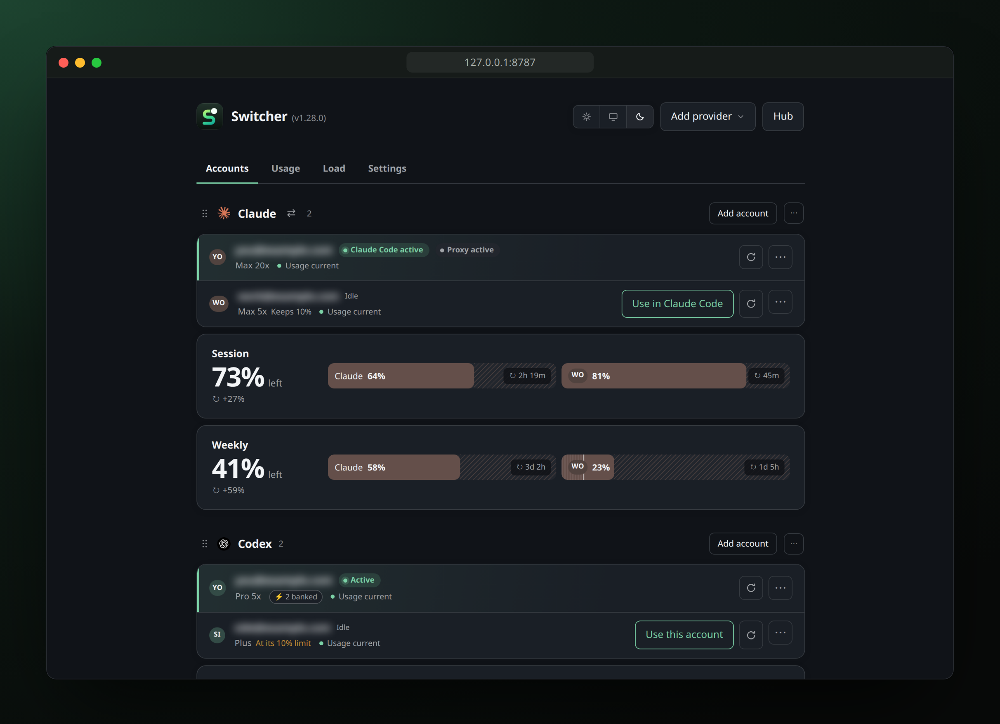<br><sub><b>Merged accounts.</b> Every account side by side per quota window.</sub></td>
    <td>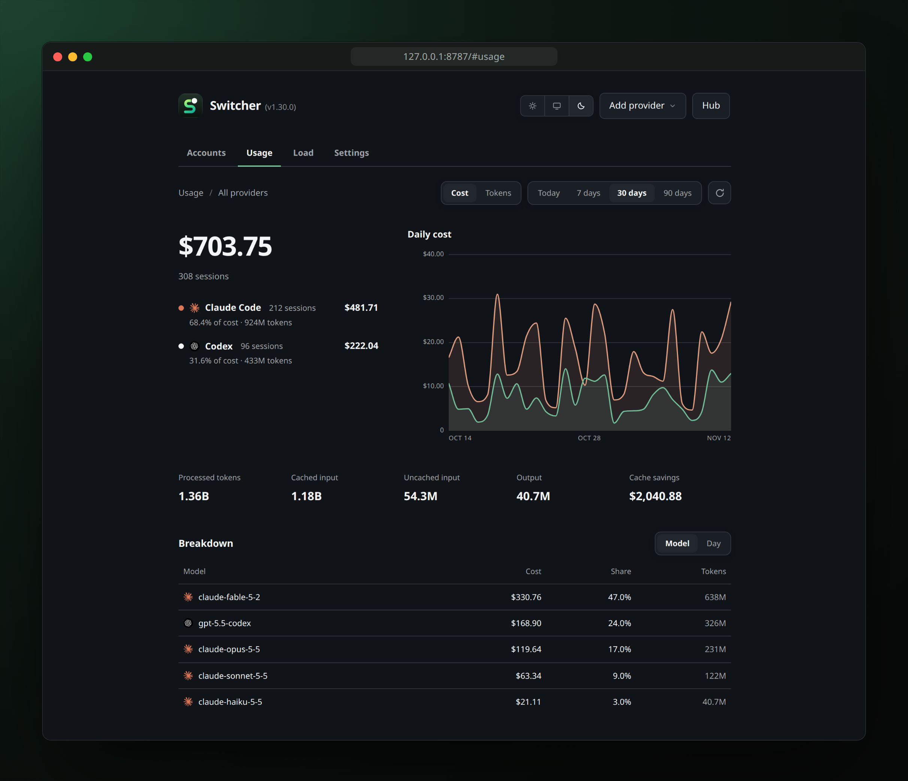<br><sub><b>Costs and tokens.</b> From your CLIs' own session logs.</sub></td>
  </tr>
  <tr>
    <td>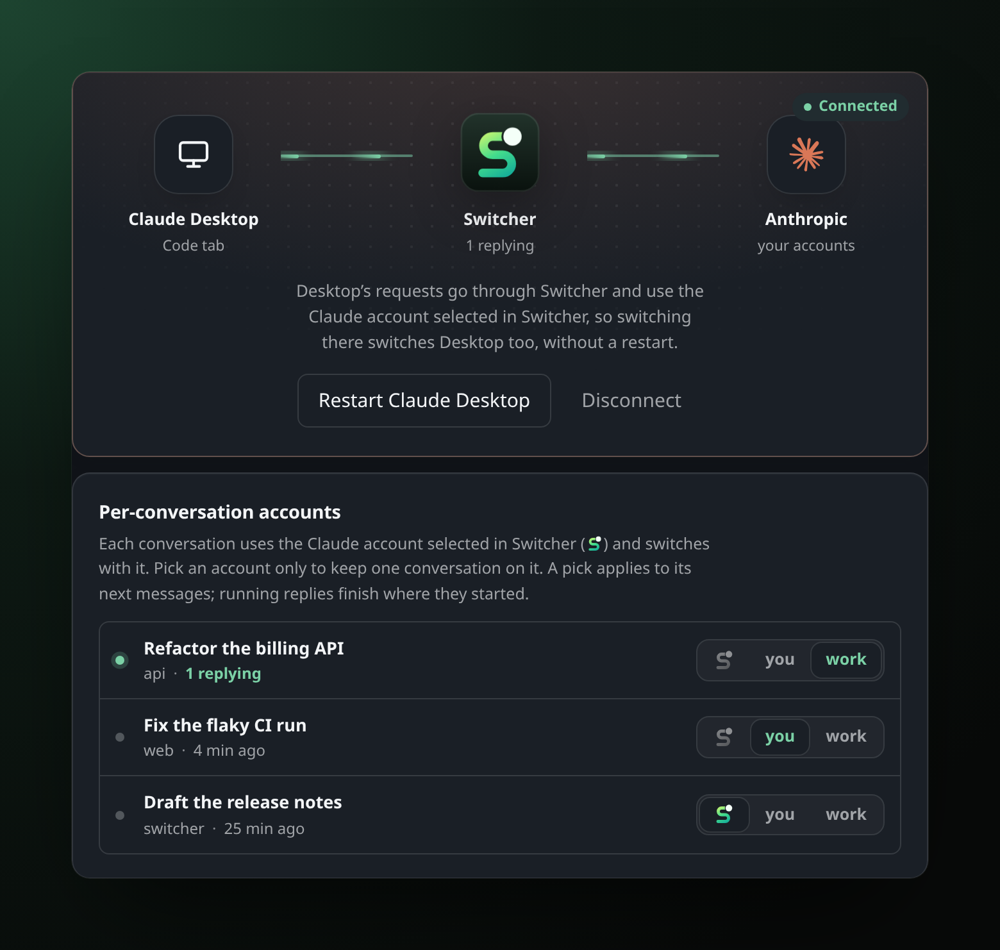<br><sub><b>Claude Desktop.</b> An account per conversation, one click each.</sub></td>
    <td>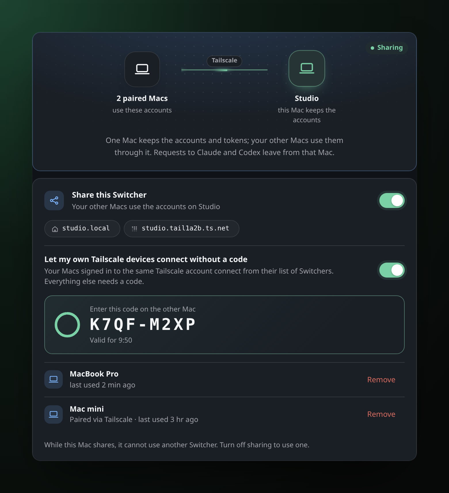<br><sub><b>Share between Macs.</b> Pair once with a code.</sub></td>
  </tr>
  <tr>
    <td colspan="2" align="center">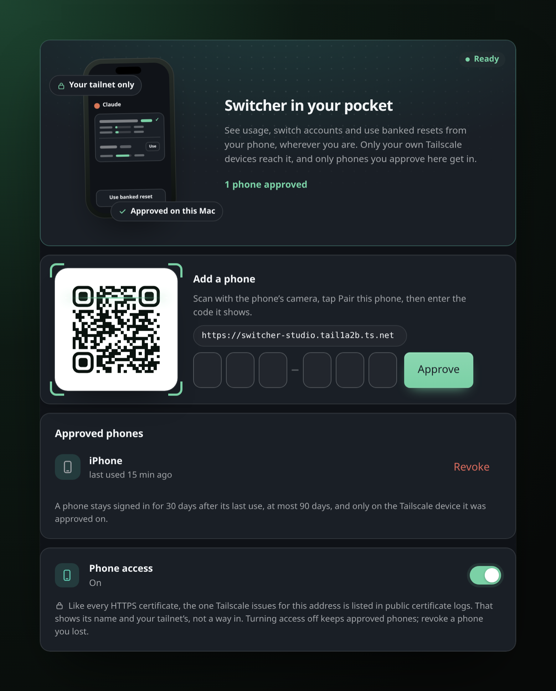<br><sub><b>Phone setup.</b> Scan, tap Pair, type the code. Done.</sub></td>
  </tr>
</table>

## Install

```sh
curl -fsSL https://raw.githubusercontent.com/00xmario/switcher/main/install.sh | sh
```

The script installs the latest release into Applications, adds the
`switcher` command, on a first install adds the skill that teaches AI agents,
Claude Code included, to use Switcher (`~/.agents/skills/switcher`;
`SWITCHER_SKILL=0` skips it) and starts Switcher. It works over SSH too.

Or download `Switcher_<version>.dmg` from
[Releases](https://github.com/00xmario/switcher/releases/latest) and drag
Switcher into Applications. Switcher is signed ad hoc rather than with a paid
Developer ID, so macOS may block the first launch of a browser download;
clear the flag once with:

```sh
xattr -dr com.apple.quarantine /Applications/Switcher.app
```

**On Linux** the same script installs `~/.local/bin/switcher`, starts it at
login with a systemd user service and opens its tray icon. The dashboard is
the main UI there; see [Switcher on Linux](docs/linux.md) for what differs.

Switcher runs on macOS 13 or later, on Apple silicon and Intel Macs, and on
Linux. It lives in the menu bar and serves its dashboard on
<http://127.0.0.1:8787>.
Turn on **Start at login** in its menu to keep it around. To build from
source (Go 1.27+): `make install`.

**Updates.** When a new release is out, the menu bar icon shows a small
arrow badge. *Install update* in the menu or the dashboard downloads the new
release straight from GitHub, checks it and replaces the whole app, then
Switcher restarts by itself; the menu and the dashboard show a progress
bar meanwhile. It always installs the newest release, skipping any in
between. A Mac that uses another Mac's accounts can update that host from
its own menu or dashboard (see [sharing](docs/sharing.md#updating-the-host)). No GitHub account or command-line tools are needed. If
Switcher sits in a folder you cannot change, such as Applications
on a standard account, macOS asks for an administrator password. Versions
up to 1.11 updated through the GitHub CLI and fail on Macs without it;
update those once with the install script above.

## Quick start

1. **Add accounts.** Open the dashboard from the menu bar and click
   **Add account**, or run `switcher login claude`. Claude can also import the
   login Claude Code already has.
2. **Switch.** Click **Use in Claude Code** or **Use this account**, or run
   `switcher use work@example.com`.
3. **Point Codex at Switcher** once: `switcher setup codex`, or
   **Settings → Command line & tools → CLI setup**.
4. **Keep a share** of an account for the chat apps: its ⋯ menu → **Usage
   limit**, or `switcher limit work@example.com 10`. Or ask your agent.

Your other Macs can skip all of this: `switcher connect <this Mac> --code <code>`
lets them use this Mac's accounts. See [sharing](docs/sharing.md).

## Command line

<p align="center">
  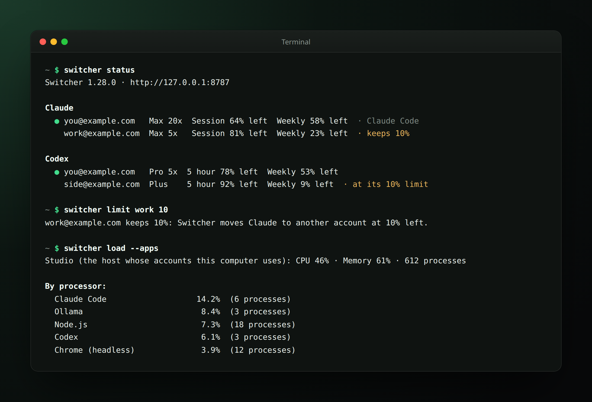
</p>

```sh
switcher status                            # accounts, usage, sharing, Claude Desktop
switcher use work@example.com              # switch; Claude also switches Claude Code
switcher login claude                      # sign in, also over SSH
switcher share on && switcher share code   # let your other Macs use this one
switcher connect studio.local --code K7QF-M2XP
switcher desktop connect                   # route Claude Desktop through Switcher
switcher limit work@example.com 10         # keep 10%: switch away at 10% left
switcher load                              # CPU, memory and GPU of this Mac or the host
switcher load --apps                       # and what is using it, by app
switcher reset codex --yes                 # spend a banked reset
switcher phone on                          # use Switcher from your phone
switcher use-host off                      # host down? work on this Mac's own accounts
switcher hand-back on --yes                # before removing Switcher: tools go direct again
switcher status --json                     # for agents and scripts
```

**Signing in over SSH works.** Open the printed link in a browser on any
device. The browser ends on a `localhost` page that cannot load; paste that
address back into the command and Switcher finishes the sign-in on its own
Mac. Agents use `--no-wait --json` and `switcher login finish`. Everything is
in the [command line guide](docs/cli.md).

## Providers

| Provider | Sign in | What Switcher does |
|---|---|---|
| **Claude** | Browser, or import Claude Code's login | Switches Claude Code's own login and the Claude proxy, by itself when an account runs out; optional Claude Desktop routing |
| **Codex** | ChatGPT in the browser | Proxy for the Codex CLI, one-command setup, banked resets |
| **Grok Build** | Device code | Proxy for the session service |
| **OpenCode Go** | API key | Proxy |
| **Gemini, Antigravity** | Google in the browser | Accounts and usage |
| **GitHub Copilot** | Device code, or import Copilot CLI | Accounts and usage |

The full matrix, including what is verified per native CLI, is in
[details](docs/details.md#providers-and-native-cli-readiness).

## Privacy and security

- By default Switcher listens on `127.0.0.1` only and needs no account of its
  own. Requests go straight from your Mac to the provider, with your tokens.
- Tokens stay in `~/.switcher/` (mode `0600`), like the CLIs keep theirs.
  Request bodies are forwarded as they are; Switcher never reads prompts.
- Sharing between Macs uses a pinned certificate, a pairing code proved in
  both directions (or, for your own Tailscale devices, Tailscale's device
  identity, checked on both sides) and a revocable token per Mac, and only
  accepts your own network and Tailscale.
- The phone page is reachable only inside your tailnet, only from your own
  Tailscale devices, and only for phones you approve on the Mac; sessions
  are bound to the phone. See [phone](docs/phone.md).
- Keeping the Mac running with the lid closed needs root once: an
  administrator approves a sudoers rule, checked with `visudo`, that lets
  your user run only `pmset disablesleep 1` and `pmset disablesleep 0`
  (`/etc/sudoers.d/switcher_lid_<user>`). Switcher turns sleep back on when
  keep awake ends and never undoes a sleep setting another app made.
- Updates come only from this repository's GitHub releases over HTTPS. The
  download must match its published SHA-256, and the new app's version,
  signature and server must check out before it replaces the old one.
- An optional dashboard password and an opt-in TLS LAN listener are in
  Settings. The full model is in [details](docs/details.md#security-model).

## Before you remove Switcher

**Settings → Command line & tools → Hand back to the providers** (or the menu
bar's **Advanced** submenu, or `switcher hand-back on --yes`) undoes Switcher's
setup: Codex gets its previous provider back,
Claude Desktop its settings, sharing turns off, and Claude Code and Codex keep
a login of their own, so your tools talk to Anthropic and OpenAI directly and
keep working once Switcher is gone. Switcher then stops using its accounts
entirely. Turning it off again sets everything back up.

## Documentation

- [Switcher in detail](docs/details.md): every feature, the switching rules, security
- [Switcher on Linux](docs/linux.md): install, the tray, what differs from a Mac
- [Command line](docs/cli.md): commands, JSON for agents, signing in over SSH
- [Share between Macs](docs/sharing.md): pairing, Away from home, what follows the host
- [Switcher on your phone](docs/phone.md): setup and who can get in
- [Claude Desktop](docs/desktop-relay-usage.md): per-conversation accounts
- [All documentation](docs/README.md), including development notes

## Development

```sh
make dev       # serve the UI from web/ (refresh to see changes)
make verify    # every check that runs before a release
```

The frontend is plain JavaScript embedded in a single Go binary; the menu bar
app is one Swift file. See [details](docs/details.md#layout) for the layout.

## Disclaimer

Switcher is an unofficial tool and is not affiliated with Anthropic, OpenAI,
xAI, Google or GitHub. It uses your own accounts on your own machine; what you
do with that is your responsibility.

## License

MIT. See [LICENSE](LICENSE) and [third-party notices](THIRD_PARTY_NOTICES.md).
Run `switcher licenses` to read the bundled notices.
